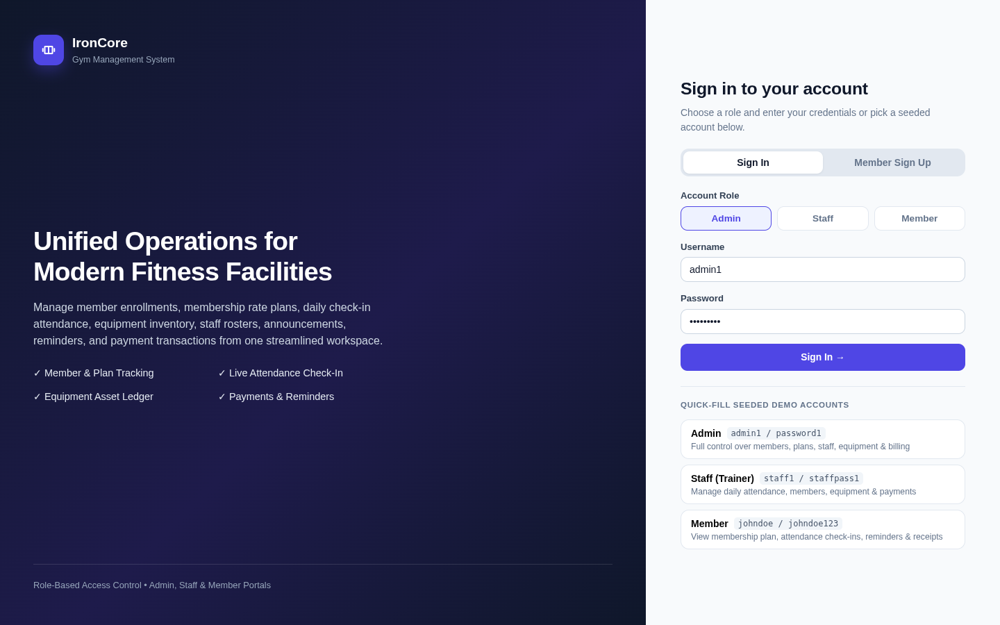
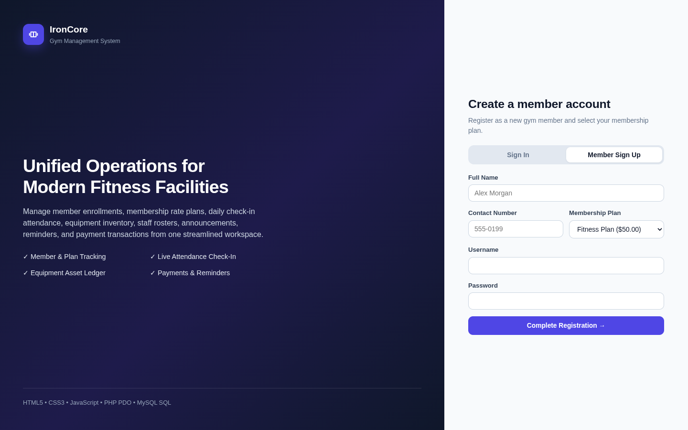
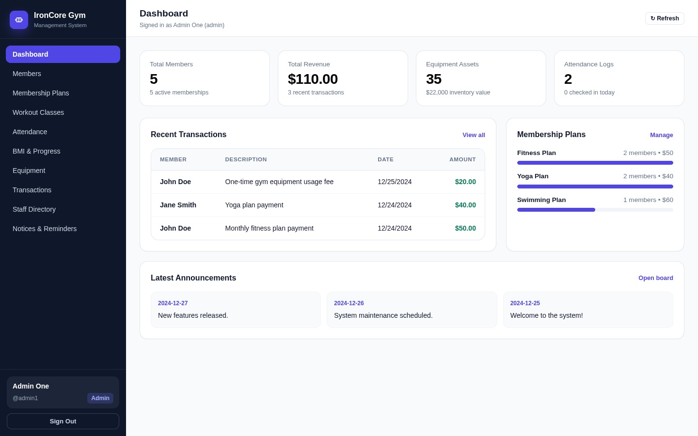
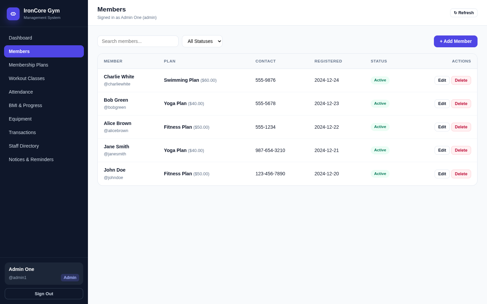
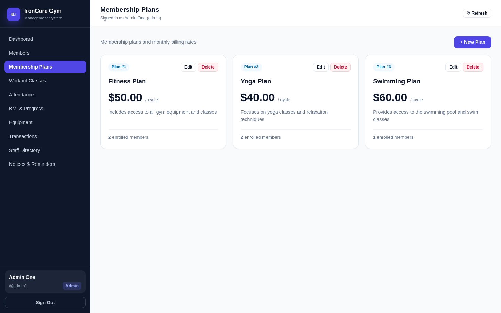
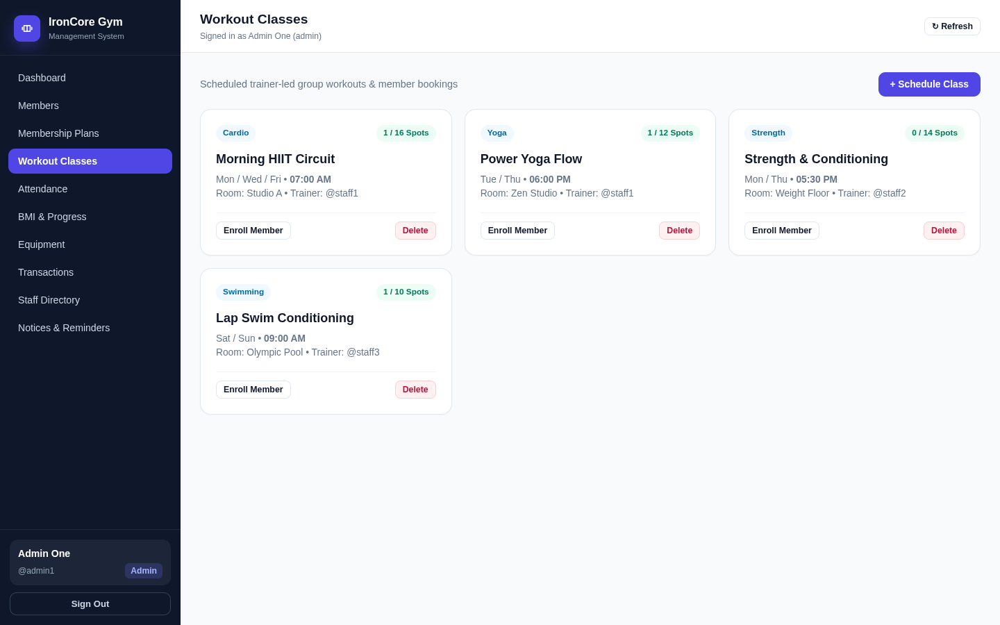
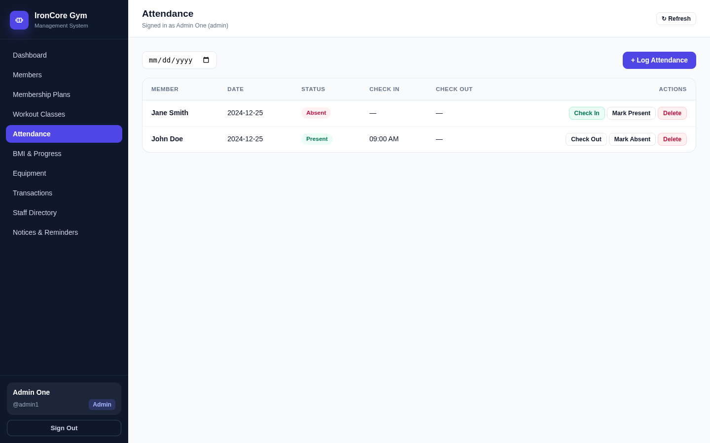
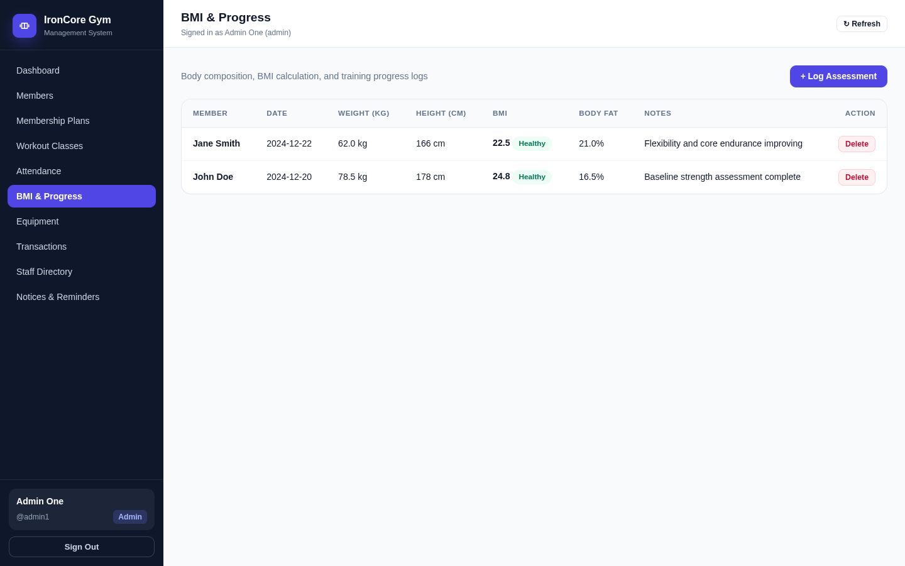
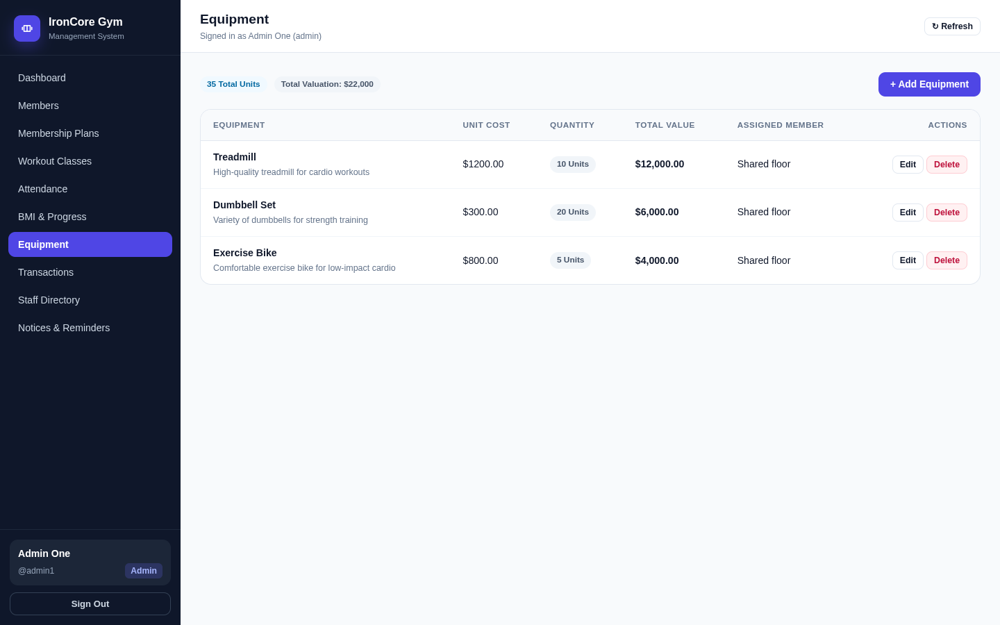
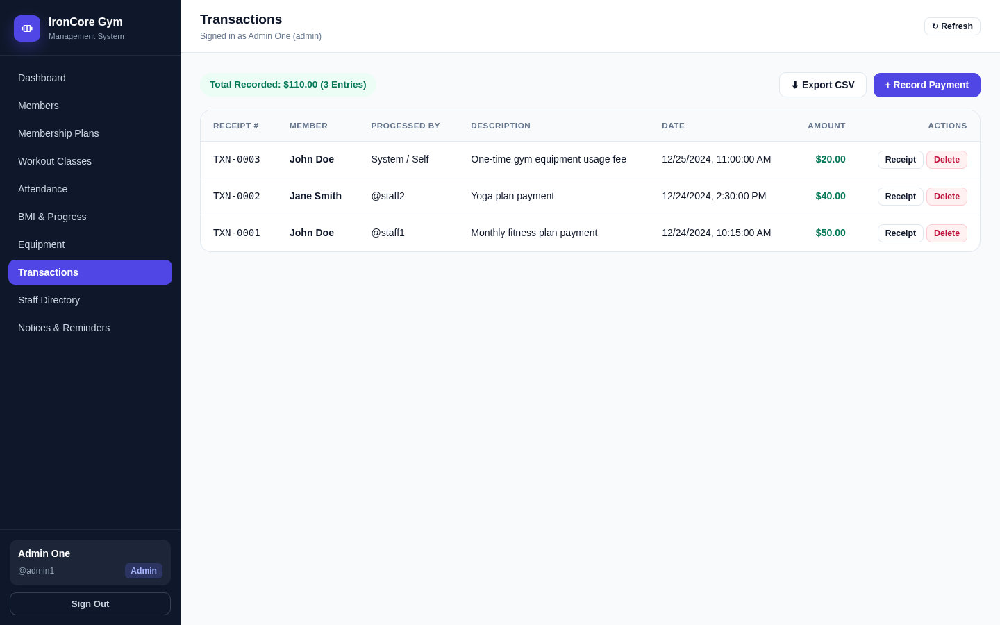

# IronCore Gym Management System

A complete, modern, responsive Gym Management System built exclusively with **HTML5, CSS3, Vanilla JavaScript, PHP (PDO), and SQL (MySQL 8+ / Oracle)** — migrated and expanded from the original Oracle APEX SQL schema (`Gym managememt System Final.sql`).

---

## Core & Modern Features

- **Role-Based Authentication & Registration**
  - Supports **Admin**, **Staff** (`trainer`, `manager`, `assistant`), and **Member** portals.
  - Self-service member sign-up with membership plan selection.
  - Quick-fill seeded demo credentials on the sign-in screen.
- **Executive Dashboard**
  - KPI summary cards for members, revenue, equipment assets, and daily attendance.
  - Membership plan enrollment bars, recent transactions ledger, and latest announcements feed.
- **Members Management**
  - Searchable and status-filterable (`active` / `inactive`) member directory with full Add, Edit, and Delete support.
- **Membership Plans (`rates`)**
  - Create, edit, and delete billing plans with live enrolled member counts.
- **Workout Classes & Seat Booking (`classes` & `class_bookings`)**
  - Schedule trainer-led group sessions (Cardio, Yoga, Strength, Swimming) with room & capacity limits.
  - Members can book or cancel class spots in real time; staff/admins can enroll members directly.
- **Daily Attendance Tracking (`attendance`)**
  - Enforces unique daily attendance per member `(member_id, attendance_date)`.
  - Supports `Present` / `Absent` status, **Check In** and **Check Out** timestamps.
- **BMI & Fitness Progress Tracker (`fitness_assessments`)**
  - Logs member weight, height, body fat %, and training notes while automatically calculating BMI and health category badges (`Underweight`, `Healthy`, `Overweight`, `Obese`).
- **Equipment Inventory (`equipment`)**
  - Track equipment assets, unit costs, quantities, total valuation, and optional member assignment.
- **Transactions, Printable Receipts & CSV Export (`transactions`)**
  - Record member payments linked to staff processors with auto-filled plan charges.
  - View and print itemized payment receipts or export transactions to CSV.
- **Staff Directory, Announcements & Scheduled Reminders (`staffs`, `announcements`, `reminder`)**
  - Manage trainers, managers, and assistants linked to supervising administrators.
  - Publish facility-wide announcements and track scheduled reminders (`Pending` → `Sent` → `Completed`).

---

## Screenshots Gallery (10 Views)

### 1. Role-Based Sign In & Demo Quick-Fill


### 2. New Member Registration


### 3. Executive Admin Dashboard


### 4. Members Directory (Search & Status Filter)


### 5. Membership Plans & Pricing (`rates`)


### 6. Workout Classes & Capacity Booking


### 7. Daily Attendance & Check-In / Check-Out


### 8. BMI & Fitness Progress Assessments


### 9. Gym Equipment Asset Inventory


### 10. Transactions Ledger, Printable Receipts & CSV Export


---

## Project Structure

```text
├── index.html                        # Semantic HTML5 UI shell
├── styles.css                        # Pure CSS3 responsive stylesheet
├── app.js                            # Vanilla ES6+ JavaScript client
├── api.php                           # PHP 8+ PDO REST API router
├── config.php                        # MySQL PDO connection & session auth helpers
├── schema.sql                        # MySQL 8+ DDL & seed data (12 tables)
├── Gym managememt System Final.sql   # Original Oracle APEX SQL script
├── server.js                         # Lightweight Node.js static + API runner for AI Studio preview
├── docs/screenshots/                 # 10 application screenshots
└── README.md                         # Project documentation
```

---

## Database Schema (`schema.sql`)

| SQL Table | Purpose | Key Constraints |
|---|---|---|
| `admin` | System administrators | Unique `username`, unique `email` |
| `rates` | Membership billing plans | Unique `name`, `charge >= 0` |
| `members` | Gym members & status | Unique `username`, FK `rate_id → rates` (`ON DELETE SET NULL`) |
| `announcements` | Facility notices | `message`, `announcement_date` |
| `attendance` | Daily check-in/out logs | Unique `(member_id, attendance_date)`, FK `member_id → members` (`ON DELETE CASCADE`) |
| `equipment` | Gym asset inventory | `quantity >= 0`, optional FK `member_id → members` (`ON DELETE SET NULL`) |
| `staffs` | Trainers & managers | Unique `username`, unique `email`, FK `admin_id → admin` (`ON DELETE CASCADE`) |
| `reminder` | Payment & class alerts | `status IN ('Pending', 'Sent', 'Completed')` |
| `transactions` | Payment receipts | `amount > 0`, FK `member_id → members` (`ON DELETE CASCADE`) |
| `classes` | Scheduled group workouts | `capacity > 0`, FK `staff_id → staffs` (`ON DELETE SET NULL`) |
| `class_bookings` | Member class reservations | Unique `(class_id, member_id)`, FKs `ON DELETE CASCADE` |
| `fitness_assessments` | Weight, height, BMI & body fat logs | `weight_kg > 0`, `height_cm > 0`, FK `member_id → members` (`ON DELETE CASCADE`) |

---

## Seeded Demo Accounts

| Role | Username | Password |
|---|---|---|
| Admin | `admin1` | `password1` |
| Staff (Trainer) | `staff1` | `staffpass1` |
| Staff (Manager) | `staff2` | `staffpass2` |
| Member | `johndoe` | `johndoe123` |
| Member | `janesmith` | `janesmith123` |

---

## How to Run in XAMPP (Recommended for Local PHP + MySQL)

This project is pre-configured to work out-of-the-box with **XAMPP** (default `root` user with an empty password in `config.php`).

1. **Install & Start XAMPP**
   - Open the **XAMPP Control Panel** and click **Start** for both **Apache** and **MySQL**.
2. **Copy Project Files into `htdocs`**
   - Copy the entire project folder into your XAMPP `htdocs` directory:
     - **Windows:** `C:\xampp\htdocs\gym-management\`
     - **macOS:** `/Applications/XAMPP/htdocs/gym-management/`
     - **Linux:** `/opt/lampp/htdocs/gym-management/`
3. **Import the MySQL Database (`schema.sql`)**
   - Open **`http://localhost/phpmyadmin`** in your browser.
   - Click the **Import** tab at the top.
   - Click **Choose File** and select `schema.sql` from your `gym-management` folder, then click **Import / Go**.
   - This automatically creates the `gym_management` database, all 12 tables, foreign keys, and seeded demo accounts.
4. **Verify `config.php` (Optional)**
   - Default XAMPP settings (`127.0.0.1`, port `3306`, database `gym_management`, user `root`, password `""`) are already set in `config.php`. Update them only if you changed your MySQL port or root password.
5. **Launch the Website**
   - Open **`http://localhost/gym-management/`** in your browser.
   - Sign in using any seeded account (e.g., `admin1` / `password1`, `staff1` / `staffpass1`, or `johndoe` / `johndoe123`), or click **Member Sign Up** to create a new member.

---

### Alternative Run Options

- **PHP Built-in Server (with MySQL running):**
  ```bash
  php -S localhost:8080
  ```
  Then open `http://localhost:8080`.
- **AI Studio Preview Runner (Node.js in-memory mode):**
  ```bash
  npm install
  npm run dev
  ```
  Runs `server.js` on `http://0.0.0.0:3000`, serving `index.html`, `styles.css`, and `app.js` and handling `api.php?action=...` endpoints in-memory where PHP/MySQL binaries are not installed.

